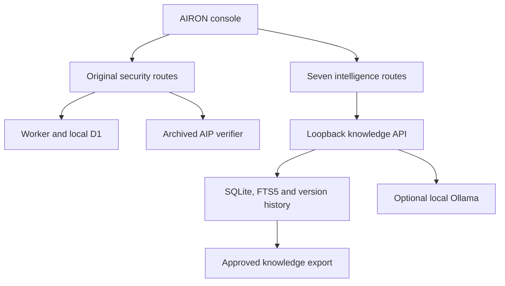

# AIRON Native enterprise intelligence walkthrough

SYNTRIASS Labs · Enterprise-Owned Sovereign Intelligence

[Current launch instructions and five-minute script for the PDF, local model and telemetry walkthrough](P0-062_DEMONSTRATION.md). The maintenance example below remains available for deterministic rehearsal.

Demonstrate an employee getting an answer from a maintenance record, a second question exceeding the record, and a separately reviewed correction becoming reusable, exportable organizational knowledge. The application keeps the knowledge, versions and review trail in a local SQLite database.

## Launch

Use Node 24, npm and Python 3.10+ with SQLite FTS5. From a clean checkout:

```sh
git clone --branch feature/airon-native-ciic-enterprise-intelligence https://github.com/richardrich999888-rgb/AIRON-native-.git
cd AIRON-native-/apps/airon-console
npm ci
npm run build
npm run db:local
npm run ciic -- --demo-personas
```

Open **http://127.0.0.1:8787/intelligence-overview** on the same computer. The UI requires that exact origin to pair with the local API on port 8766. Select Mira and click **Open workspace**. **Switch identity** changes the presenter’s fictional persona. A second browser can independently pair with the same local demo workspace. The demonstration repository persists at `~/.airon-native/ciic-fictional/knowledge.sqlite`. Use `--directory /path/to/new/evaluation` for a fresh walkthrough. Restart both services with the same directory to retain knowledge. Re-pair after a service restart.

For a locally controlled evaluation, omit `--demo-personas`. The launcher uses a separate `enterprise/` database and prints separate ephemeral pairing keys. Distribute each key only to its assigned operator. In either mode the inherited security dashboard has its own demo session and live-data boundary. To select an installed local Ollama model, append `--model YOUR_LOCAL_TAG` and choose **Local Ollama** in the workspace. Initial dependency installation requires network access. The deterministic route requires no model download.

## What to say on each Enterprise Intelligence page

Open with “I’ll show you how a maintenance record becomes an answer an employee can check, and how a gap in that record becomes a procedure a second employee can use.”

| Page in sidebar order | What to show and say |
| --- | --- |
| Intelligence Overview | “Select a source document. We can see who imported it, how many approved versions came from it, and how often those versions were used to answer a question.” |
| Knowledge Vault | “Here is the original inspection protocol. An administrator can import a text or Markdown file. We can open the record, read the source, and check who imported it and its SHA-256 fingerprint.” |
| Private AI Workspace | “When should we inspect the cooling assembly? The answer is every 200 operating hours, and here is the document it came from. Now I’ll ask which register records the handover. That detail is missing, so AIRON abstains.” |
| Expert Teach | “The expert proposes the handover procedure, links the source and adds a supporting reference. A separate reviewer checks the change and decides whether to activate it.” |
| Institutional Memory | “A second employee can now ask the handover question. This page shows the approved answer, its version, the expert, the reviewer and the reuse count. An administrator can export the knowledge.” |
| Sovereign Runtime | “Let’s check what is running on this computer. The probe reports local database size, service CPU time and availability of the configured Ollama model. This walkthrough uses the source-excerpt engine.” |
| Trust & Evidence | “Here we can follow the handover question from abstention to approval and release of an answer. Each event shows the actor, time and details. These are local application records. The AIP verification button opens the separate execution-evidence verifier.” |

## Five-minute presentation

| Time | Presenter action | Evidence to show |
| --- | --- | --- |
| 0:00–0:40 | Open Intelligence Overview as Mira, then Knowledge Vault. Click **Import sample maintenance document**. Expand the document. | The local record contains its actual source text, origin, timestamp and SHA-256. |
| 0:40–1:25 | Open Private AI Workspace, switch to Dev. Select **Inspection interval** and **Ask workspace**. Then ask **Handover register**. | The first answer quotes the maintenance source. The second abstains because the imported document does not identify a handover register. |
| 1:25–2:20 | In Expert Teach switch to Leela. Enter the exact handover question below, the proposed answer, the related vault document and the supporting reference. Submit for review. | The proposal identifies its author and remains pending. |
| 2:20–3:00 | Switch to Ravi, inspect the evidence and choose **Approve and activate**. | The reviewer decision assigns version 1. Further approved revisions receive new version numbers. |
| 3:00–3:45 | In another browser window or profile open Private AI Workspace, pair as Nila and ask **Handover register**. | The answer identifies the approved version and source hash. |
| 3:45–4:35 | As Mira, open Institutional Memory. Inspect the author, reviewer, evidence, version and reuse count. Choose **Export approved knowledge**. | The JSON contains source documents, approved procedures, provenance, audit records and timestamps. |
| 4:35–5:00 | Open Trust & Evidence. Expand the approval and answer events. Open Sovereign Runtime and probe the local runtime if time permits. | Unsigned knowledge events and archived AIP execution verification have distinct evidence scopes. |

**Question** — Which register records the cooling assembly handover?

**Procedure** — Record the cooling assembly handover in the fictional shift register MH-04.

**Supporting reference** — Fictional maintenance addendum MH-04, section 2, witnessed by the shift lead.

## Architecture



## Baseline and integration inventory

| Area | Finding |
| --- | --- |
| Source | Read-only pinned VANIAN checkout at e574a03206d29a4cf1d4fd8637231999f43b2aaf. The feature/vanian-accountability-console tip had no subsequent app changes at audit time. Other inspected tips, including claude/vanian-enterprise-wow, diverge from the pinned app. |
| Destination | Additive app under apps/airon-console, based on AIRON main 04a84e64fc2be36fe03fc73006c9a42285617a02. The existing website, offline gateway and research branches retain their source. |
| UI | React 19.2.6, Next-compatible Vinext, Vite, locally bundled Inter and JetBrains Mono, shadcn components, TanStack Table/Query, ECharts, React Flow and Three.js. |
| Navigation | docs/CIIC_NAVIGATION_BASELINE.json records all 46 original routes, their labels, route and group icons, identifiers and APIs. The first group adds seven routes. |
| Original application | Catch-all app routes, tenant-scoped demo D1 records, authenticated live bridge, historical WASM verification, policy editing, investigation drawers, spatial graph, FinOps and administration. The original Cloudflare deployment configuration is retained for that application. The local knowledge service requires its own process. |
| Research | Reused the AIRON main offline Python gateway functions and fixture. Reviewed unified runtime d91eb982d22f164c808d770d30989d4e2e61fe4b, including Docling ingestion, native retrieval, llama.cpp, capability approval and adapter research. Those paths require a separately provisioned runtime, models and trust material. This console directly integrates the compatible main-branch adapter. |
| Licensing | See apps/airon-console/PROVENANCE.md and preserved dependency notices. |

## Capability boundaries

**Implemented.** Local TXT/Markdown import, SQLite storage, FTS5 vault search, deterministic supported-question lookup, cited excerpts, abstention, proposal and review, immutable version history via the API, reuse counting, audit and export. Local model selection and failure handling use AIRON’s existing Ollama adapter. The runtime reports measured database size and model availability.

**Simulated.** The built-in maintenance document and selectable profiles are samples. Picking an identity in this mode is a presentation convenience. The original security dashboard’s synthetic telemetry is separately labeled.

**Planned.** Production identity federation for the knowledge service, granular document ACLs, multi-organization provisioning, encryption/key custody, independently signed knowledge records and richer semantic retrieval. All paired identities in one knowledge workspace can read its imported documents.

**Research.** Model-weight adaptation, autonomous continual learning and compute optimization remain separate research tracks. Approving a procedure updates retrieval data. Installed-model inference requires its own measured run. Air-gap operation, model-weight ownership and production certification are outside this qualification.

## Recorded application screens

These Chromium captures show the built application at 1440 × 960 on desktop and 390 × 844 on mobile. The intelligence records come from the scripted fictional maintenance walkthrough. The inherited security and FinOps views show their labeled synthetic tenant.

| | |
| --- | --- |
| [Workspace sign-in](ciic-screens/00-login.png) | [Mobile sign-in](ciic-screens/11-mobile-login.png) |
| [Security dashboard](ciic-screens/01-dashboard.png) | [Intelligence Overview](ciic-screens/02-intelligence-overview.png) |
| [Knowledge Vault](ciic-screens/03-knowledge-vault.png) | [Private AI Workspace](ciic-screens/04-private-workspace.png) |
| [Expert Teach](ciic-screens/05-expert-teach.png) | [Institutional Memory](ciic-screens/06-institutional-memory.png) |
| [Sovereign Runtime](ciic-screens/07-sovereign-runtime.png) | [Trust & Evidence](ciic-screens/08-trust-evidence.png) |
| [Agent Lineage](ciic-screens/09-agent-lineage.png) | [AI FinOps · Spending](ciic-screens/10-ai-finops.png) |
| [Mobile Knowledge Vault](ciic-screens/12-mobile-vault.png) | [Mobile navigation](ciic-screens/13-mobile-navigation.png) |

## Reproduce validation and capture

From apps/airon-console:

```sh
npm run lint
npm run typecheck
npm run build
npm run test:core
python3 -m unittest discover -s intelligence -v
npx playwright install chromium
CIIC_CAPTURE_DIR="$PWD/../../docs/ciic-screens" npx playwright test tests/ui/intelligence.spec.ts
npm run test:ui
```

Use an unused 8766/8787 port pair for the intelligence browser test. It provisions a disposable local repository, imports an actual file through the UI, switches identities, restarts the service, opens a second browser context and inspects the exported JSON. It captures sign-in, the dashboard, seven intelligence pages, Agent Lineage, Spending and mobile navigation. The original native qualification script can additionally run all optional tests with a pinned AIP checkout and Rust 1.99.1. The AIRON CIIC workflow builds and exercises the original app before testing the rebrand. Its screenshot artifact is named **CIIC-console-screens**.


## P0-060 local validation record

The pinned application and branded application both passed production builds under Node 24.22.3. The branded TypeScript check passed. ESLint reported zero errors and 22 warnings. The core suite passed 20 tests, including both navigation-preservation assertions, with six native-binary-dependent checks skipped locally. Eight ownership and access tests passed, including re-opening the store, concurrent review, source ambiguity and unavailable inference. All eight existing AIRON website engine tests passed. Browser and full native qualification use the GitHub runner because this local shell disallows browser sockets.

## P0-060 hosted qualification — 23 November 2026

[Completed GitHub Actions run](https://github.com/richardrich999888-rgb/AIRON-native-/actions/runs/45204756788) for implementation commit `0b579ac08c69a6345d585f38dc241b87a2b40efd`.

| Check | Result |
| --- | --- |
| Original pinned VANIAN app | Clean dependency install, production build and rendered Home drill-down passed before testing the branded copy. |
| AIRON build and static checks | Production build and TypeScript passed. ESLint reported 0 errors and 22 warnings. |
| Knowledge ownership and access | 8 Python tests passed. |
| Native verifier, adapters and navigation | 26 tests passed, including previously skipped native cases. Zero failures and zero skips. |
| Browser qualification | All 17 Playwright cases passed without retries, including inherited security interactions, accessible/mobile navigation, the full maintenance workflow, actual file import, independent review, persisted cross-user reuse and inspected JSON download. |
| Screens | 10 actual application screenshots captured. |

During the first capture the FinOps check used an exact text selector, while the original table heading includes its live row count. The corrected test checks the named heading, selected allocation dimension and rendered SVG chart. The subsequent run passed. The production UI used the deterministic extraction engine for the maintenance demo. These results qualify that demonstrated path and the tested AIP cases.
