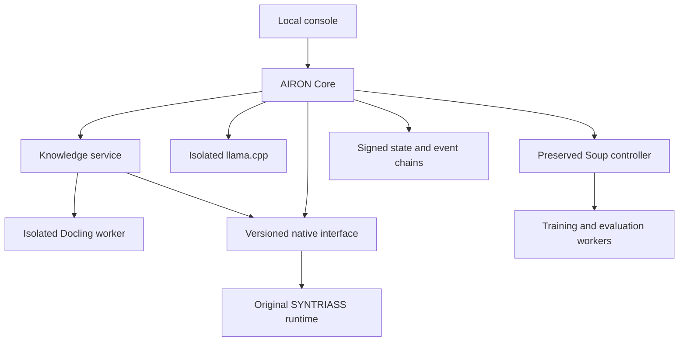

# P0-056 runtime architecture

Tested source: AIRON initial lifecycle `16c6bd745edacaa4ad7b435cc52de935e1d1802f`; final qualification target `0f4cd7e20f4c19577b5a73b9d1dacdc221f3085a`; native interface `f1ba9fc2072dac1431543fd4961baaa2762b8ea9`. See `BENCHMARKS.json` and `evidence/local/PROVENANCE.json` for per-run revisions. Local hardware: Linux 6.18.57, AMD EPYC 9V74, 9 visible CPUs, 10,206,472 KiB RAM, no GPU; inference comparisons restricted to CPUs 0–1. Hosted hardware: Ubuntu 22.04, Linux 6.8 Azure, 4 visible CPUs, 16,371,436 KiB RAM; the corrected two-CPU run enforced an 8 GiB cgroup limit but training timed out; separate four-CPU training and two-CPU serving qualification is in progress. No claim of independent administration.

`Core.call(principal, operation, params)` owns the request boundary. The provisioned principal is bound to a server-issued random token; request JSON cannot replace actor, role, tenant or clearance. The server listens only on loopback and validates Host, Origin, request type, size and operation. This is owner-local authentication, not independently administered enterprise identity.

The native JSON protocol is `syntriass-airon-bridge/v1`. Its binary, configuration and per-actor identity files are checked against provisioned SHA-256 values. Identity files are owner-readable only. Native SQL filters tenant and clearance before returning passages. AIRON additionally verifies each returned source hash against its signed committed document version before passing content to inference. An unauthorized or missing source abstains without a model call.

The typed procedure language cannot call a model or tool. A signed, trusted expert suite must pass; the scoped reviewer grant must authorize that version; explicit approval and activation are separate actions. Compilation alone grants no execution authority. Native audit bytes and capability files are anchored in signed AIRON state. A public snapshot permits later offline verification without private keys. Trust roots and final heads still need custody outside the potentially compromised application host.

Training reuses P0-052 unchanged through a pinned private Python adapter. Training, evaluation, parsing and inference execute in separate restricted processes/network namespaces. One heavy-work slot serializes these operations. The minimum serving process stays small; training frameworks are not loaded into the controller. A pending training job blocks other heavy workers; fast deterministic execution can remain available. Queue and memory limits fail closed. Per-process limits and 20ms aggregate RSS sampling are supplementary to the hosted cgroup qualification.

The learning controller recommends retrieval update, capability proposal/update, adapter training, or expert intervention. A recommendation is never an approval. Task outcomes are retained with `trusted_fact=false`. Documents, procedures, outcomes, adapters, evaluations and deployment history remain distinct record kinds/stores.

This implementation provides application-signed evidence. It does not assert independent observation, production trust-root custody, autonomous skill acquisition or defence certification.
